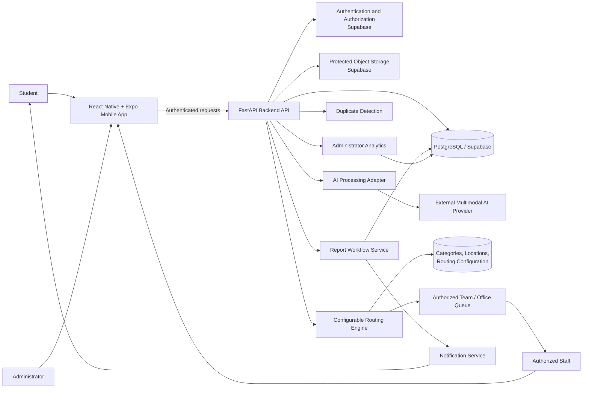

# LancerSnap Architecture

**Document purpose:** Persistent technical context for developers and AI coding agents  
**Project:** LancerSnap — AI-Assisted CBU Campus Reporting Application  
**Architecture baseline:** Software Design Document (SDD) v0.2  
**Implementation plan:** `docs/Implementation-Plan.md`  
**Repository:** `https://github.com/JudahAzariah/LancerSnap`

---

## 1. Purpose and Authority

This file records the durable architecture that contributors and AI coding agents must preserve when implementing LancerSnap. It describes the system boundaries, major components, data flow, technology choices, and architectural constraints. It is not a replacement for the SDD or the Implementation Plan.

Use these artifacts in this order:

1. **SDD v0.2** (`docs/LancerSnap_Software_Design_Document_v0.2.pdf`) defines the approved product scope, user stories, requirements, and design decisions.
2. **Implementation Plan** (`docs/Implementation-Plan.md`) defines the five implementation phases, candidate work items, dependencies, acceptance criteria, and sequencing.
3. **GitHub Issues and the LancerSnap Development Roadmap Project** track the detailed work, current status, and human review state.
4. **This file** preserves long-lived technical structure and boundaries that apply across individual issues.

If an implementation detail is not specified in these artifacts, do not silently invent a product requirement, CBU operational process, external integration, or architectural commitment. Record the open question and request a human decision when it affects scope, security, data contracts, or operational behavior.

## 2. Product and System Boundary

LancerSnap is a mobile-first campus issue reporting and workflow-support application for California Baptist University (CBU).

The primary student workflow is:

**Sign in → Snap & Report → Capture/select photo → Confirm campus location → Optional note → Submit → Receive report receipt → Track status.**

After submission, the backend can request AI analysis, validate and persist the advisory result, apply administrator-configured routing rules, and make the report available to an authorized staff queue. Authorized staff review the report and make operational decisions. Students see the current persisted status and configured updates.

The system supports three principal application roles:

- **Student:** submits a photo-first campus issue report and tracks their own reports.
- **Campus staff:** reviews reports within an authorized team/office scope, reviews AI suggestions, updates permitted statuses, and resolves issues.
- **LancerSnap administrator:** manages supported categories, routing configuration, authorized access configuration, and aggregated report-trend views.

Operational teams are represented as configurable teams or role-based queues. Examples in the SDD (such as Housing/Residential Assistants, Facilities, Dining, Building Administration, and IT/Technology Support) are candidates, not confirmed statements of official CBU ownership. Validate actual CBU mappings before production use.

### Explicit system exclusions

The architecture must not introduce the following into the current MVP:

- Harassment, disciplinary, or sensitive personal-complaint workflows.
- Direct emergency-service dispatch or integration with 911, police, fire, or EMS.
- Facial recognition or identification of people from submitted photographs.
- Continuous GPS tracking.
- Automated consequential administrative, disciplinary, safety, or staff decisions.
- Replacement of CBU work-order, facilities-management, or case-management systems.
- Full campus-wide integration with every university information system.
- Native desktop applications or advanced predictive campus forecasting.

LancerSnap is not an emergency-response system. The application must direct users who need immediate assistance to the appropriate emergency service or campus emergency channel.

## 3. Selected Technology and Service Boundaries

| Layer | Technology / Service | Responsibility and boundary |
|---|---|---|
| Mobile client | React Native + Expo | Cross-platform mobile experience for students and role-restricted staff/administrator interfaces. |
| Backend | FastAPI (Python) | API endpoints, request validation, application business logic, report operations, authorization enforcement, routing orchestration, and external-service coordination. |
| Relational data | PostgreSQL | Persistent records for users/roles, reports, categories, locations, routing rules, status history, AI metadata, duplicate candidates, and notification metadata. |
| Managed platform | Supabase | Managed authentication, PostgreSQL services, and protected object storage for the prototype. |
| AI provider | External multimodal AI service (provider/model not yet selected) | Analyzes approved report image/note content and returns structured advisory classification, details, priority, and potential-duplicate information. |
| Notifications | Notification service (provider/channel not yet selected) | Delivers configured student-facing status updates based on persisted report events. |
| Location reference | Supported CBU campus location data | Supplies building/location choices in the reporting flow. It is not continuous device tracking. |

The external AI provider and notification provider remain open decisions. Do not select or hard-code a provider, credentials, delivery channel, or cost commitment without an approved decision.

## 4. High-Level Architecture

The diagram is logical rather than a deployment topology. Exact API routes, database table names, hosting arrangement, and third-party provider choices are implementation decisions unless separately approved and documented.

## 5. Component Responsibilities

### 5.1 Mobile Application

- Presents the photo-first **Snap & Report** flow.
- Lets a student capture/select a photo, confirm a supported campus location, optionally add a note, and submit.
- Displays an honest submission receipt or failure state and a report identifier after successful submission.
- Provides the student's own report list, report details, current status, and permitted reopen action.
- Presents role-restricted staff and administrator experiences.
- Labels AI-generated values as suggestions and does not present them as confirmed facts.
- Does not require the student to choose the responsible CBU team.
- Does not request continuous GPS tracking.

### 5.2 Authentication and Authorization

- Establishes authenticated user identity and application role context.
- Supports student, campus staff, and administrator permissions.
- Restricts students to their own reports.
- Restricts staff to reports within their authorized team/office scope.
- Restricts category/routing configuration and administrative analytics to authorized administrators.
- Treats backend authorization as authoritative; hiding a screen or control in the client is not sufficient security.

### 5.3 Backend API

- Validates authenticated requests, report input, supported locations, and media references.
- Creates the report record and returns a unique identifier/receipt.
- Coordinates AI analysis, duplicate detection, routing, status transitions, and notifications.
- Enforces authorization and business rules for report access and state changes.
- Remains the authoritative application boundary for persisted report state.

### 5.4 AI Processing Adapter

- Sends only approved report content to the selected external multimodal provider.
- Validates the provider response against an application-defined structured schema before persistence or downstream use.
- Records suggested category, summary/details, priority suggestion, uncertainty/confidence information, processing status, and provider metadata as appropriate to the approved schema.
- Clearly distinguishes model-generated suggestions from staff-confirmed values.
- Handles provider timeouts, unavailable service, invalid responses, and other failures without losing an otherwise valid report submission.
- Keeps provider credentials and secrets server-side; never embed them in the mobile application or commit them to the repository.

The AI service is an external dependency, not the system of record and not an authorization authority. It must not independently assign consequential work, change a report's status, resolve a report, or make a safety or administrative decision.

### 5.5 Duplicate Detection

- Evaluates available report attributes such as category, location, submission time, text similarity, and image similarity where supported.
- Returns potential-overlap suggestions for staff review.
- Does not automatically merge, delete, or close reports.
- Preserves separate reports when staff determine that similar submissions refer to different issues.

The exact detection technique and whether image similarity is needed remain open implementation decisions. Start with the attributes and staged evaluation described in the SDD and Implementation Plan; do not introduce a vector database or other technology without an approved design decision.

### 5.6 Routing Engine

- Applies active administrator-configured rules using supported report attributes, particularly category and location; priority may be considered where the approved configuration defines it.
- Directs a report to a configured organizational team or role-based queue, not permanently to an individual employee.
- Supports manual-review fallback when classification or routing is uncertain or no valid destination is configured.
- Allows authorized staff workflows to correct or reassign a report when permitted.
- Does not hard-code unverified department names, personal contacts, or assumed CBU procedures into the student interface or scattered application logic.

The actual CBU category-to-team mapping must be validated with CBU before production use.

### 5.7 Report Workflow Service

- Enforces allowed report status transitions on the backend.
- Supports report assignment/acceptance, status updates, resolution, and permitted reopening.
- Records status history with the previous/new status, actor, timestamp, and optional staff update/resolution note.
- Ensures unauthorized users cannot change report status.

The SDD defines the statuses `Submitted`, `Assigned`, `In Progress`, `Resolved`, `Reopened`, and `Closed`. The distinction and exact transition rules for `Closed` remain an open implementation decision; do not silently choose semantics that change the approved workflow.

### 5.8 Database and Protected Media Storage

- Persists application records in PostgreSQL.
- Stores uploaded photographs separately in protected object storage.
- Keeps media private by default and applies access checks consistent with report permissions.
- Stores references/metadata for media rather than making uploaded files publicly accessible by default.
- Persists report state and status history as the authoritative record.

Exact table names, column types, indexes, constraints, and relationships are to be defined during database implementation and captured in migrations/schema documentation. Do not assume this conceptual file has already selected those details.

### 5.9 Notification Service

- Creates configured student-facing status updates from persisted report events.
- Tracks notification attempt/delivery state and failure metadata as appropriate.
- Treats notification delivery as a side effect separate from the report state.
- Does not roll back or falsify a saved report status when delivery fails.

The provider and exact delivery channel remain open decisions.

### 5.10 Administrator Configuration and Analytics

- Allows authorized administrators to create, update, and deactivate supported categories.
- Allows authorized administrators to configure category/location/team routing rules.
- Produces aggregate report views by supported category, location, status, or time period.
- Uses persisted report data as the basis for analytics rather than independent counters that can drift.

## 6. Primary Data Flow

1. The student authenticates and opens **Snap & Report**.
2. The student captures or selects a photograph, confirms a supported campus location, and optionally adds a note.
3. The mobile client submits the report to the backend.
4. The backend validates the authenticated user, input, location, and media reference.
5. The backend stores the report and protected photograph reference, then returns a report identifier/receipt. A valid report submission must remain possible if the external AI service is unavailable.
6. When available, the backend requests AI analysis. The response is schema-validated and persisted as advisory information, including uncertainty where applicable.
7. Duplicate detection may identify potentially similar reports; suggestions remain reviewable and do not automatically merge or close reports.
8. The routing engine applies the active category/location/team configuration. If classification or routing is uncertain, or no valid destination exists, the report enters the configured manual-review path.
9. Authorized staff review the report, AI suggestions, and any duplicate indication, then decide what action to take.
10. Staff update the report status or resolve the issue. The backend validates the transition and records status history.
11. The student sees the current persisted status and receives configured status notifications. A notification failure does not erase or alter the saved status.

## 7. Conceptual Data Areas

The SDD defines the following logical data areas. This list is conceptual; exact schema decisions belong in database migrations and implementation documentation.

| Data area | Representative information |
|---|---|
| Users and roles | Authenticated user identifier, role, and authorized team/office membership. |
| Reports | Report identifier, submitter, category, optional description/note, location, timestamps, current status, and assigned team. |
| Report media | Protected storage object reference, authorization context, and upload metadata. |
| Locations | Supported campus building/location identifiers and display names. |
| Categories | Administrator-managed supported categories and active/inactive state. |
| Routing rules | Category/location conditions, destination team, active state, and configuration history where required. |
| AI analysis | Suggested category, summary/details, suggested priority, uncertainty/confidence information, processing status, and provider metadata. |
| Duplicate candidates | Potentially related report identifiers, similarity signals, review state, and staff disposition. |
| Status history | Previous/new status, actor, timestamp, and optional staff resolution/update note. |
| Notifications | Notification event, recipient, channel, delivery state, and failure metadata. |

## 8. Security, Privacy, and Reliability Rules

These architectural rules implement the SDD constraints and must be preserved across issues:

1. **Backend authorization is authoritative.** Enforce access on protected operations; client-side visibility rules alone are not security.
2. **Student data is scoped.** A student can read only their own reports.
3. **Staff data is scoped.** Staff can access only reports within their authorized team/office scope.
4. **Admin operations are restricted.** Category/routing configuration and analytics require administrator authorization.
5. **Media is private by default.** Original uploaded photos must not be publicly accessible by default.
6. **Secrets stay server-side.** AI provider credentials and other secrets must not be embedded in the mobile app or committed to GitHub.
7. **AI output is untrusted advisory data.** Validate its schema, preserve uncertainty, and never use it as sole authority for consequential action.
8. **Report persistence is independent of AI availability.** A valid report must remain submittable when external AI analysis fails; analysis can be retried or sent for human review.
9. **Failure states must be truthful.** Database, storage, AI, routing, and notification failures must be visible and must not produce a false success state.
10. **Notifications are not the system of record.** Persisted report status remains authoritative when notification delivery fails.
11. **Duplicate suggestions are non-destructive.** Do not automatically merge, delete, or close reports based on similarity.
12. **No continuous location tracking.** Use supported campus location choices; do not add continuous GPS tracking.
13. **Emergency limitations are visible.** LancerSnap does not dispatch emergency services.
14. **Accessible interaction is required.** Core reporting, tracking, and staff operations need readable labels, sufficient contrast, and indicators that do not rely on color alone.

## 9. Implementation Dependencies

The Implementation Plan owns the detailed phase plan and candidate issues. At the architecture level, preserve this dependency order:

1. **Foundation:** mobile/backend project structure, authentication, roles, database foundation, location/category reference data, and access policies.
2. **Photo-based reporting:** protected media, location selection, report submission, receipt, and student report views.
3. **AI and routing:** validated AI integration/schema, classification, priority/uncertainty handling, duplicate suggestions, configurable routing, and manual-review fallback.
4. **Staff workflow:** authorized queues, report details, assignment, status transitions, notifications, resolution, and reopening.
5. **Analytics and validation:** aggregated views, security/privacy/accessibility checks, failure-path tests, end-to-end validation.

Do not implement downstream behavior before its required data contract and authorization boundary exist. The Implementation Plan and GitHub Issues provide the detailed sequencing and dependencies.

## 10. Open Architecture Decisions

The following decisions are intentionally not made by this file because the SDD identifies them as open:

| SDD reference | Open decision | Rule for implementation agents |
|---|---|---|
| OQ-01 | CBU team and category routing | Do not invent official team ownership. Use configurable placeholder/reference data until validated. |
| OQ-02 | Staff workflow integration | Do not assume full integration with existing CBU systems; implement only the approved MVP workflow. |
| OQ-03 | AI provider and model | Keep the provider behind an adapter/configuration boundary; evaluate before selecting. |
| OQ-04 | Duplicate detection approach | Evaluate category, location, time, and text first; image similarity is conditional on need and feasibility. |
| OQ-05 | Campus location reference | Use a supported, maintainable location list; confirm its content and owner. |
| OQ-06 | Notification provider | Keep the provider/channel replaceable until selected. |
| OQ-07 | Production single sign-on | Do not claim or implement production CBU SSO without approval and access. |

The SDD also leaves the exact `Closed` status semantics and transition rules open. Record the decision before implementing behavior that depends on it.

## 11. Architecture Change Rules for AI Coding Agents

Before changing architecture-sensitive code, an agent must:

1. Read this file, the relevant SDD requirements, and the linked GitHub Issue.
2. Identify which component owns the behavior and preserve the component boundaries above.
3. Preserve backend authorization, private media storage, server-side secrets, and human-owned decisions.
4. Avoid coupling the mobile UI directly to an external AI provider or embedding provider credentials in the client.
5. Validate and persist AI output as advisory information before downstream use.
6. Keep report submission and status persistence reliable when optional external services fail.
7. Keep categories, locations, routing destinations, and notification provider choices configurable where the SDD requires configuration or leaves the choice open.
8. Avoid adding out-of-scope features or unapproved CBU integrations.
9. Update architecture documentation when an approved change alters component responsibilities, data flow, trust boundaries, or technology choices.
10. If a required decision is unresolved, stop at the boundary, document the assumption, and ask the human project owner rather than silently choosing.

---

## 12. Traceability Reference

| Architecture topic | SDD references |
|---|---|
| Student photo-first submission and location | US-01, US-06; DD-01, DD-02 |
| AI classification and uncertainty | US-02, US-08; RC-02; DD-03 |
| Student status, resolution updates, and reopening | US-03, US-04, US-05; RC-12 |
| Staff access, status updates, and resolution | US-07, US-09, US-10; RC-01, RC-03 |
| Routing and team queues | US-11; RC-04, RC-05; DD-04, DD-05 |
| Duplicate suggestions | RC-06; DD-06 |
| Safety priority and emergency boundary | RC-07, RC-08; DD-09 |
| Protected media and service failures | RC-09, RC-10; DD-08 |
| Accessibility | RC-11 |
| Administrator categories and analytics | US-12, US-13 |
| MVP scope boundary | DD-10 |

For the full normative wording, consult SDD v0.2. This table is a navigation aid, not a replacement for the requirements.
