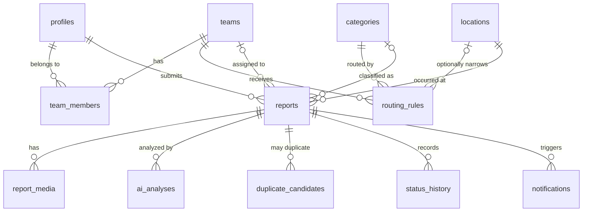

# LancerSnap — Database Schema

The PostgreSQL schema for LancerSnap, as created by the migrations in
`supabase/migrations/`. It implements the conceptual data areas in SDD v0.2
§5.6. The migration files are the source of truth; this page explains them.

## Tables

| SDD data area | Table | What a row is |
| :--- | :--- | :--- |
| Users and roles | `profiles` | One per signed-in user: their application role. Identity itself lives in Supabase `auth.users`. |
| Users and roles | `teams` | An operational team / role-based queue that can receive reports. |
| Users and roles | `team_members` | A staff member's membership in a team; defines which reports they may see. |
| Locations | `locations` | A supported campus building or location. |
| Categories | `categories` | An administrator-managed report category. |
| Routing rules | `routing_rules` | "Reports of this category (optionally at this location) go to this team." |
| Reports | `reports` | A submitted campus issue report. |
| Report media | `report_media` | A reference to a photograph held in private object storage. |
| AI analysis | `ai_analyses` | One AI analysis attempt for a report. Advisory only. |
| Duplicate candidates | `duplicate_candidates` | A suggestion that two reports may describe the same issue. |
| Status history | `status_history` | One status change: from, to, who, when, optional note. |
| Notifications | `notifications` | One notification attempt for a student, with its delivery state. |

## Relationships



## Design rules built into the schema

- **Roles** are `student`, `staff`, `administrator`. Every new user gets a
  `student` profile automatically; elevated roles are assigned deliberately.
- **Report statuses** are exactly the SDD §6.4 set: `submitted`, `assigned`,
  `in_progress`, `resolved`, `reopened`, `closed`. The schema restricts the
  *values*; which *transitions* are allowed is enforced by the backend (LS-20).
- **Routing targets teams, never individuals** (RC-05, DD-05). `routing_rules`
  has a `team_id` and no user column. A rule with no location applies to every
  location; a rule with a location is more specific. At most one active rule
  exists per category, and per category + location.
- **Category: suggested vs. confirmed** (US-08). `reports.category_id` is the
  category currently used for routing and display. It is staff-confirmed only
  when `category_confirmed_by` is set. The AI's own suggestion is kept
  separately in `ai_analyses.suggested_category_id`.
- **AI output is advisory** (RC-02, RC-03). `ai_analyses` stores the
  suggestion, confidence, and an explicit `is_uncertain` flag. Each retry is a
  new row; the newest row is the current result. Nothing in the schema lets an
  AI row change a report's status.
- **Duplicate suggestions are non-destructive** (RC-06). A
  `duplicate_candidates` row only links two reports and records the staff
  disposition (`pending`, `confirmed_duplicate`, `not_duplicate`).
- **Photos are references, not public files** (RC-09). `report_media` stores
  the storage bucket and object path; the file is in private storage (LS-08).
- **Status history is the audit trail** (RC-12). `actor_id` is null when the
  system made the change.
- **Notifications are a side effect.** A failed delivery is recorded in
  `notifications`; it never changes `reports.status`.
- **Report reference codes** (`RPT-000001`, …) are generated by the database
  and are unique.

## Access control

Access follows SDD RC-01 and is enforced in two layers.

**1. The backend (authoritative).** The FastAPI backend connects with a
server-side connection string and is the only writer. It looks up the caller's
role and team membership on every request (`backend/app/authz.py`) and scopes
every query accordingly.

**2. Row-level security (second layer).** For anything that reaches Supabase
directly with a user's token, the policies in
`20261116010000_access_policies.sql` allow **read-only** access:

| Table | Student | Staff | Administrator |
| :--- | :--- | :--- | :--- |
| `reports` | own reports | reports assigned to a team they belong to | all |
| `report_media`, `ai_analyses`, `status_history` | for reports they can see | for reports they can see | all |
| `duplicate_candidates` | none | for reports assigned to their team | all |
| `notifications` | own | own | all |
| `profiles` | own | own | all |
| `teams`, `team_members` | none / own rows | own team / own rows | all |
| `locations`, `categories` | active rows | active rows | all |
| `routing_rules` | none | none | all |

- Signed-out callers (`anon`) have no access to any table.
- No role can insert, update, or delete through the public API, including
  administrators. All writes go through the backend.
- A user counts as staff for a team only while their role is `staff` **and**
  they have a membership row; removing the staff role removes the scope.
- The policy helper functions live in a non-exposed `private` schema.

### Roles and the first administrator

Every new account starts as `student`. Administrators assign roles and team
membership through the backend (`/admin/users` endpoints). Because only an
administrator can do that, the **first** administrator is set once, by hand,
in the Supabase SQL Editor:

```sql
update public.profiles set role = 'administrator'
where id = (select id from auth.users where email = 'you@example.edu');
```

## Decisions made here and still-open questions

- **Priority values** are `low`, `medium`, `high`. The SDD requires a
  recommended priority but does not name the levels; this is an implementation
  choice that can be changed by a later migration.
- **`closed` exists as a status value only.** How a report reaches `closed`
  is an open decision (SDD §6.4) to be made before LS-20.
- **No reference data is seeded here.** Categories and locations come in LS-05;
  teams and routing rules are configuration pending CBU validation (OQ-01,
  OQ-05).
- **Manual-review routing** (LS-17) and any further columns will be added by
  later migrations rather than guessed now.

## Applying migrations

Migrations are plain SQL files, applied in filename order.

**Supabase SQL Editor (simplest):** open the project dashboard → SQL Editor →
paste the contents of each new file in `supabase/migrations/` → Run. Apply each
file once, in order.

**Supabase CLI (optional):** `supabase link --project-ref <ref>` then
`supabase db push`.

To confirm the schema is in place, run this in the SQL Editor. It should return
12 rows, each with `rls_enabled = true`:

```sql
select relname as table_name, relrowsecurity as rls_enabled
from pg_class
where relnamespace = 'public'::regnamespace and relkind = 'r'
order by relname;
```

## Testing migrations

The tests apply every migration to a clean, in-memory PostgreSQL (PGlite) and
check tables, constraints, and the access policies for each role. They never touch a real
Supabase project.

```bash
cd supabase
npm install
npm test
```
