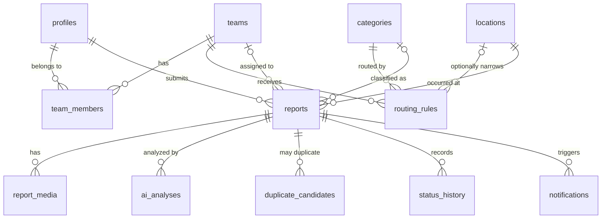

# LancerSnap — Database Schema

The PostgreSQL schema for LancerSnap, as created by the migrations in
`supabase/migrations/`. It implements the conceptual data areas in SDD v0.2
§5.6. The migration files are the source of truth; this page explains them.

## Tables

| SDD data area | Table | What a row is |
| :--- | :--- | :--- |
| Users and roles | `profiles` | One per signed-in user: their application role. Identity itself lives in Supabase `auth.users`. |
| Users and roles | `teams` | An operational team / role-based queue that can receive reports. |
| Users and roles | `team_members` | A staff member's membership in a team; defines which reports they may see. |
| Locations | `locations` | A supported campus building or location, with a type and an active flag. |
| Categories | `categories` | An administrator-managed report category. |
| Routing rules | `routing_rules` | "Reports of this category (optionally at this location) go to this team." |
| Reports | `reports` | A submitted campus issue report. |
| Report media | `report_media` | A reference to a photograph held in private object storage. |
| AI analysis | `ai_analyses` | One AI analysis attempt for a report. Advisory only. |
| Duplicate candidates | `duplicate_candidates` | A suggestion that two reports may describe the same issue. |
| Status history | `status_history` | One status change: from, to, who, when, optional note. |
| Notifications | `notifications` | One notification attempt for a student, with its delivery state. |

## Relationships



## Design rules built into the schema

- **Roles** are `student`, `staff`, `administrator`. Every new user gets a
  `student` profile automatically; elevated roles are assigned deliberately.
- **Report statuses** are exactly the SDD §6.4 set: `submitted`, `assigned`,
  `in_progress`, `resolved`, `reopened`, `closed`. The schema restricts the
  *values*; which *transitions* are allowed is enforced by the backend (LS-20).
- **Routing targets teams, never individuals** (RC-05, DD-05). `routing_rules`
  has a `team_id` and no user column. A rule with no location applies to every
  location; a rule with a location is more specific. At most one active rule
  exists per category, and per category + location.
- **Category: suggested vs. confirmed** (US-08). `reports.category_id` is the
  category currently used for routing and display. It is staff-confirmed only
  when `category_confirmed_by` is set. The AI's own suggestion is kept
  separately in `ai_analyses.suggested_category_id`.
- **AI output is advisory** (RC-02, RC-03). `ai_analyses` stores the
  suggestion, confidence, and an explicit `is_uncertain` flag. Each retry is a
  new row; the newest row is the current result. Nothing in the schema lets an
  AI row change a report's status. A row starts `pending` (queued with the
  report), then becomes `succeeded` or `failed`; a failure keeps a short reason
  in `error_message` (for example `timeout`) and no result (LS-11). The fields
  of a result and how they are validated are described in
  [AI-Analysis-Schema.md](AI-Analysis-Schema.md) (LS-12).
- **Duplicate suggestions are non-destructive** (RC-06). A
  `duplicate_candidates` row only links two reports and records the staff
  disposition (`pending`, `confirmed_duplicate`, `not_duplicate`). How
  candidates are found is described below (LS-15).
- **Photos are references, not public files** (RC-09). `report_media` stores
  the storage bucket and object path; the file is in private storage (LS-08).
- **Status history is the audit trail** (RC-12). `actor_id` is null when the
  system made the change.
- **Notifications are a side effect.** A failed delivery is recorded in
  `notifications`; it never changes `reports.status`.
- **Report reference codes** (`RPT-000001`, …) are generated by the database
  and are unique.

## Reference data: locations and categories

`20261116020000_locations_and_categories.sql` seeds the two lists the reporting
flow needs. Both are configuration data, managed by administrators through the
backend (`/admin/locations`, `/admin/categories`) with no schema or app change.

- **Locations** — 20 campus locations supplied by the project owner. Each has a
  `name`, a `location_type`, and `is_active`. `location_type` is free text in
  lower-case identifier form (`building`, `residential`, `outdoor_area`,
  `parking` so far), so a new kind of location is just a new value. More
  specific places (a floor, a room, a named lot) can be added as further rows.
- **Categories** — the six candidate categories from SDD §2.3, each with a
  short description of the kind of issue. Descriptions never name a
  responsible office; who handles a category is routing configuration.
- **Nothing is ever deleted.** A location or category that is no longer
  offered is deactivated: it disappears from the lists used for new reports
  but stays on historical reports.

## Report photo storage

`20261116030000_report_media_bucket.sql` creates the private Supabase Storage
bucket `report-media` (RC-09).

- **Private, with no storage policies.** Nobody can list, read, upload, or
  delete files in it with a user token or the publishable key.
- **All access goes through the backend**, which checks permissions and then
  issues a short-lived signed URL for exactly one file:
  - *Upload* (`POST /media/uploads`, students only): the backend validates the
    declared type and size, chooses the path (`<uploader id>/<random>.<ext>`),
    and records a `report_media` row not yet attached to a report.
  - *View* (`GET /media/{id}/url`): only the uploader for an unattached photo;
    otherwise anyone who may view the report — its submitter, staff on the
    report's assigned team, or an administrator. The link is valid for 5 minutes.
- **Limits:** JPEG, PNG, WebP, HEIC/HEIF; 10 MB. Enforced by the backend and
  again by the bucket itself.
- A missing photo and a photo you may not see return the same "not found".
- Storage failures return an error to the caller and record nothing (RC-10).

## Duplicate detection (LS-15)

`backend/app/duplicates.py` records possible duplicates in
`duplicate_candidates`. It follows the first stage of OQ-04: category,
location, submission time, and text. Image similarity is not used (deferred by
OQ-04), and no other technology is involved.

Two reports are paired when they are at the **same location**, were submitted
within **`DUPLICATE_WINDOW_HOURS`** (default 72) of each other, and either:

- both have a category and it is the **same** one; or
- at least one has no category yet, and their **text** (note plus AI summary)
  overlaps by at least **`DUPLICATE_TEXT_THRESHOLD`** (default 0.3, word
  overlap from 0 to 1).

Reports with different categories are never paired. A report's category here
is the staff-confirmed one, otherwise its newest validated AI suggestion. The
window and threshold are implementation choices, not SDD values; OQ-04 itself
remains open for later stages such as image similarity.

- **When it runs:** after each AI analysis finishes (succeeded or failed), or
  at submission when AI analysis is turned off. It runs in its own savepoint:
  if it fails, the report and its analysis are unaffected.
- **What it stores:** one row per pair (never both directions), with
  `similarity_signals`: `rule`, `same_location`, `same_category`,
  `hours_apart`, `text_similarity`. At most 10 new candidates per run. Running
  it again never duplicates a pair or undoes a staff decision.
- **What it never does:** change, merge, close, or delete a report.
- **Who sees candidates:** staff who handle the report (its team) and
  administrators, through `GET /reports/{id}/duplicates`, and only candidates
  whose other report they can also handle. Students cannot see them.
- **Staff decisions:** `PATCH /reports/{id}/duplicates/{candidate_id}` with
  `not_duplicate` (keep both reports separate), `confirmed_duplicate`, or
  `pending`. It records who decided and when. Confirming is only a record:
  nothing is merged or closed.

## Access control

Access follows SDD RC-01 and is enforced in two layers.

**1. The backend (authoritative).** The FastAPI backend connects with a
server-side connection string and is the only writer. It looks up the caller's
role and team membership on every request (`backend/app/authz.py`) and scopes
every query accordingly.

**2. Row-level security (second layer).** For anything that reaches Supabase
directly with a user's token, the policies in
`20261116010000_access_policies.sql` allow **read-only** access:

| Table | Student | Staff | Administrator |
| :--- | :--- | :--- | :--- |
| `reports` | own reports | reports assigned to a team they belong to | all |
| `report_media`, `ai_analyses`, `status_history` | for reports they can see | for reports they can see | all |
| `duplicate_candidates` | none | for reports assigned to their team | all |
| `notifications` | own | own | all |
| `profiles` | own | own | all |
| `teams`, `team_members` | none / own rows | own team / own rows | all |
| `locations`, `categories` | active rows | active rows | all |
| `routing_rules` | none | none | all |

- Signed-out callers (`anon`) have no access to any table.
- No role can insert, update, or delete through the public API, including
  administrators. All writes go through the backend.
- A user counts as staff for a team only while their role is `staff` **and**
  they have a membership row; removing the staff role removes the scope.
- The policy helper functions live in a non-exposed `private` schema.

### Roles and the first administrator

Every new account starts as `student`. Administrators assign roles and team
membership through the backend (`/admin/users` endpoints). Because only an
administrator can do that, the **first** administrator is set once, by hand,
in the Supabase SQL Editor:

```sql
update public.profiles set role = 'administrator'
where id = (select id from auth.users where email = 'you@example.edu');
```

## Decisions made here and still-open questions

- **Priority values** are `low`, `medium`, `high`. The SDD requires a
  recommended priority but does not name the levels; this is an implementation
  choice that can be changed by a later migration.
- **`closed` exists as a status value only.** How a report reaches `closed`
  is an open decision (SDD §6.4) to be made before LS-20.
- **Teams and routing rules are unverified examples.**
  `20261119000000_example_routing.sql` (LS-16) seeds the five example teams
  named in SDD §1.3, each called "(example, unverified)", and four
  category-wide example rules: Facilities / maintenance → Facilities,
  Housing / residential → Housing / Residential Assistants, Dining or campus
  service-location → Dining, IT / technology → IT / Technology Support.
  "Potential safety hazard" and "Other supported campus issue" have no rule,
  so they go to manual review. None of this is confirmed CBU ownership
  (OQ-01); administrators change it in the app (Routing settings) or through
  `/admin/teams` and `/admin/routing-rules`.

## Routing (LS-16)

`backend/app/routing.py` runs after each AI analysis. A report is routed when
it is still `submitted` with no team, its newest validated analysis is
**confident** (has a category, not uncertain), and an active rule for that
category matches at an active team. A rule for the report's own location wins
over a category-wide rule. Routing sets `assigned_team_id` (a team, never a
person), records the category used (still unconfirmed), moves the report to
`assigned`, and adds a system `status_history` entry with no actor and no
note, so the student sees "Assigned" without being told which team. Reports
that are uncertain, failed, unanalyzed, or match no rule stay `submitted` for
the manual-review fallback (LS-17). Routing never moves a report that is
already assigned, and a routing failure never affects the analysis.
- **Manual-review routing** (LS-17) and any further columns will be added by
  later migrations rather than guessed now.

## Applying migrations

Migrations are plain SQL files, applied in filename order.

**Supabase SQL Editor (simplest):** open the project dashboard → SQL Editor →
paste the contents of each new file in `supabase/migrations/` → Run. Apply each
file once, in order.

**Supabase CLI (optional):** `supabase link --project-ref <ref>` then
`supabase db push`.

To confirm the schema is in place, run this in the SQL Editor. It should return
12 rows, each with `rls_enabled = true`:

```sql
select relname as table_name, relrowsecurity as rls_enabled
from pg_class
where relnamespace = 'public'::regnamespace and relkind = 'r'
order by relname;
```

## Testing migrations

The tests apply every migration to a clean, in-memory PostgreSQL (PGlite) and
check tables, constraints, and the access policies for each role. They never touch a real
Supabase project.

```bash
cd supabase
npm install
npm test
```
